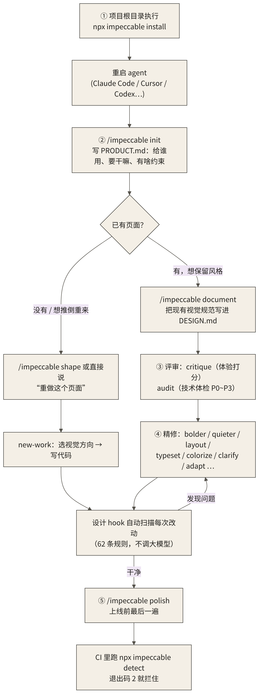
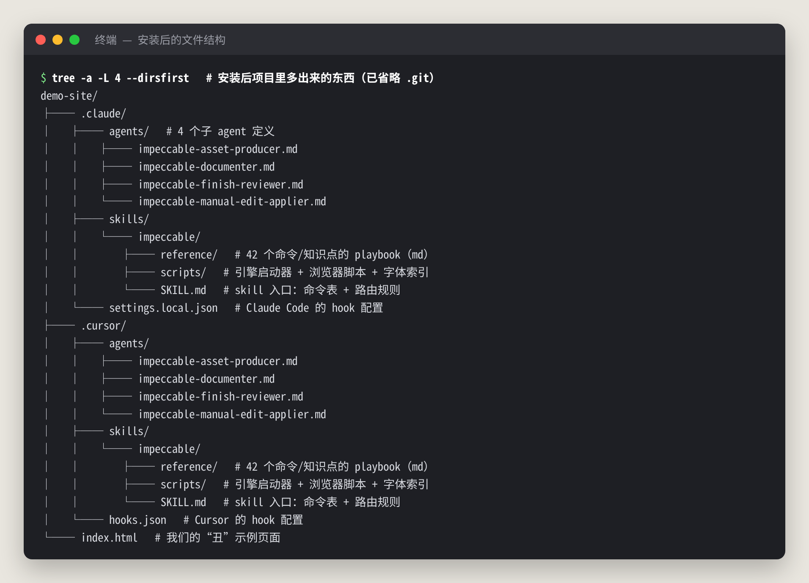
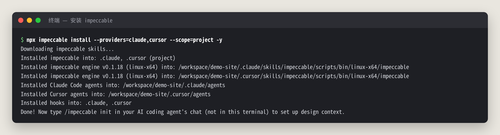
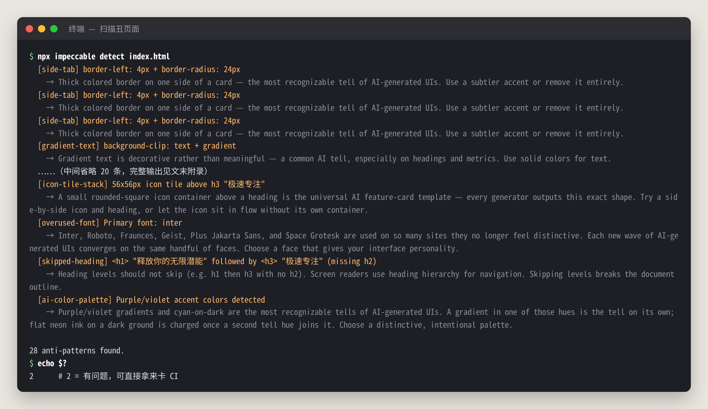

# impeccable 中文教程：让 AI 写的前端不再“一眼 AI 味”

> **非官方中文教程**。原项目 [pbakaus/impeccable](https://github.com/pbakaus/impeccable)（Apache-2.0），本仓库与原作者无关。

📚 免费版只讲“是什么、怎么装、检测器怎么用”。完整版（命令逐个讲解、实战案例、踩坑排错、中文提示词示例）在知识星球「开源抢先站」：[https://t.zsxq.com/mc4td](https://t.zsxq.com/mc4td)

🎟️ 首发 6 折：新人先领 20 元券，50 元变 30 元（限 50 张，11 月 29 日截止）👉 [领券](https://t.zsxq.com/jk0TT)

> 适用版本：impeccable npm 包 v4.8.0（内置检测引擎 v0.1.18）｜实测日期：2026-10-30  
> 文中所有终端输出、截图都来自真机实测，不是 README 的翻译。

## 目录

- [0. 先说结论：值不值得装？](#0-先说结论值不值得装)
- [1. 它到底是什么？解决什么问题？](#1-它到底是什么解决什么问题)
- [2. 安装：按你用的 agent 来](#2-安装按你用的-agent-来)
- [3. 检测器：零成本先扫一遍](#3-检测器零成本先扫一遍)
- [4. 完整版还讲了什么](#4-完整版还讲了什么)
- [来源与许可](#来源与许可)

---

## 0. 先说结论：值不值得装？

如果你平时用 Claude Code、Cursor、Codex 这类编程 agent 写前端，那你一定见过这种页面：

- 满屏 Inter 字体
- 紫色到蓝色的大渐变
- 一个圆角小方块图标 + 标题 + 两行灰字的“三张功能卡”
- 渐变色大数字：10x、99%、1M+

**Impeccable 干的事，就是专门治这种“AI 味”。** 它有三样东西：

1. **一套设计 skill**：给 agent 装上 24 个设计命令（`critique`、`audit`、`polish`、`bolder`……）。每个命令背后都是一份专门写好的设计 playbook。你说“更大胆一点”，agent 就不用再自己瞎猜了。
2. **一个“AI 味”检测器**：62 条确定性规则，**不调大模型、不要 API Key**，本地秒出结果，可以直接放进 CI。
3. **一个设计 hook**：agent 每改一次 UI 文件就自动扫一遍，把问题塞回给 agent，让它自己修完再交差。

我的实测结论是：

- **检测器 + hook 是最值钱的部分。** 零成本、确定性、能进 CI，装了不亏。
- **critique / audit 两个评审命令质量很高。** 它会给出具体行号、对比度数值和 P0~P3 优先级，比“帮我看看哪里不好看”靠谱得多。
- **重做页面（redesign）的效果确实惊艳**（见下方前后对比图），但很吃 token：一次重做用了约 5.9 万 token，要有心理准备。



## 1. 它到底是什么？解决什么问题？

用一句大白话说：**Impeccable = 给编程 agent 配的“设计总监 + 质检员”。**

agent 写前端难看，根子不在“它不会写 CSS”，而在两件事上：

| 问题 | 表现 | Impeccable 的解法 |
|---|---|---|
| **没有设计语境** | 不知道产品给谁用、什么调性，只能套最安全的模板 | `init` 生成 `PRODUCT.md`，`document` 生成 `DESIGN.md`，之后每个命令都先读它们 |
| **你说不清要什么** | “做得高级一点”“再 pop 一点”，agent 只能猜 | 24 个命名清楚的命令，每个对应一份专门的 playbook |
| **没人验收** | 写完就交，AI 套路一个不落 | 检测器 + hook，每次改动自动扫描，逼 agent 自查 |

装好之后，它在项目里大概长这样：



几个要点：

- `SKILL.md` 是入口，里面是命令表和路由规则。agent 看到 `/impeccable xxx` 就会去 `reference/xxx.md` 里读对应的 playbook。
- `reference/` 里有 42 份 md，不只是命令，还有“各种页面类型怎么设计”“iOS / Android 规范”“色彩、排版”这些知识文件。
- `scripts/` 里有一个**自带的二进制引擎**（Rust 写的，linux-x64 / mac / win 都有）。检测、上下文加载、hook 全靠它，不依赖你本机装什么。
- 体积说明：每个工具目录大约 24MB（主要是引擎二进制）。装给三个工具就是三份。

## 2. 安装：按你用的 agent 来

### 2.1 通用方式（推荐）：一条命令

在**项目根目录**执行：

```bash
npx impeccable install
```

它会自动识别你装了哪些编程工具，问你装到当前项目还是全局，再问要不要装设计 hook。**hook 一定选 Yes**（hook 的原理和各家差异在完整版里细讲）。

想脚本化、不想交互的话：

```bash
npx impeccable install --providers=claude,cursor --scope=project -y
```

这是我实测的输出：



装完**一定要重启你的 agent**（Claude Code 重开会话，Cursor 重载窗口），不然它读不到新 skill。

常用的管理命令：

```bash
npx impeccable update          # 升级已有安装
npx impeccable check           # 检查是否有新版本
npx impeccable telemetry off   # 关闭匿名统计（也可设环境变量 DO_NOT_TRACK=1）
```

### 2.2 各家 agent 的差异（重点看你自己用的那家）

| Agent | 安装方式 | 怎么调用 | hook 支持 | 额外一步 |
|---|---|---|---|---|
| **Claude Code** | `npx impeccable install`，或 `/plugin marketplace add pbakaus/impeccable` 后在 `/plugin` 里安装 | `/impeccable critique 首页` | ✅ 改完即扫 + 结束时深度扫描 | 无 |
| **Cursor** | `npx impeccable install --providers=cursor` | `/impeccable ...` | ⚠️ 只在 **Write** 后扫，**没有**结束时的深度扫描 | 可能需要在设置里开启 Agent Skills |
| **Codex CLI** | `npx impeccable install --providers=codex`（装到 `.agents/`） | `$impeccable ...`（注意是 `$` 不是 `/`），或者 `/skills` 里选 | ✅ | 必须在 Codex 里打开 `/hooks`，手动批准项目 hook |
| **GitHub Copilot（VS Code）** | 插件市场搜 `renaissance-geek.impeccable`，或 `code --install-extension renaissance-geek.impeccable` | 同上 | ❌ 插件版不带 hook | 需要 VS Code 1.109.3+ |
| **Grok Build** | `grok plugin install pbakaus/impeccable#plugin --trust` | `/impeccable ...` | ✅ | `/hooks-trust` 或带 `--trust` 启动 |
| **Gemini CLI / Trae / Qoder / OpenCode 等** | `npx impeccable install`，或手动复制 | `/impeccable ...` | ❌（手动复制时） | Trae 复制后要重启；OpenCode 还要复制 `.opencode/commands/impeccable.md` |

**没有 Node 环境？** 可以手动复制。克隆仓库后，把对应工具目录下的 `skills/impeccable` 复制到你项目的同名目录：

```bash
# 例：给 Claude Code 装
mkdir -p 你的项目/.claude/skills
cp -r impeccable/.claude/skills/impeccable 你的项目/.claude/skills/
```

对照表：Claude Code → `.claude/`，Cursor → `.cursor/`，Codex → `.agents/`，Copilot → `.github/`，Gemini → `.gemini/`，Grok → `.grok/`，Trae → `.trae/`（国内版是 `.trae-cn/`），Qoder → `.qoder/`。

> ⚠️ 手动复制**不带 hook 和子 agent**。能用 npx 就用 npx。

各家 hook 配置文件的位置（install 会自动写好，这里列出来方便你排查）：

- Claude Code：`.claude/settings.local.json`，注册了 `SessionStart`、`PostToolUse(Edit|Write)` 和 `Stop` 三个事件
- Cursor：`.cursor/hooks.json`，只有 `postToolUse`，matcher 是 `^Write$`
- Codex：`.codex/hooks.json`，注册了 `PostToolUse(Edit|Write|apply_patch)` 和 `Stop`

## 3. 检测器：零成本先扫一遍

装好之后，不用打开任何 agent、不花一个 token，就能先给页面做个“AI 味”体检：

```bash
npx impeccable detect index.html           # 扫文件或目录
npx impeccable detect http://localhost:5173 # 扫渲染后的页面（需要本机有 Chrome）
```

我故意手写了一个“标准 AI 味”落地页（Inter 字体、紫色渐变、渐变文字、左边带色条的卡片、圆角 emoji 图标块、10x / 99% / 1M+ 大数字），扫出来是这样：



28 条问题。按规则统计：

| 规则 | 次数 | 说明 |
|---|---:|---|
| `low-contrast` | 14 | 文字对比度不达标 |
| `gradient-text` | 5 | 渐变文字 |
| `side-tab` | 3 | 卡片单边粗色条 |
| `icon-tile-stack` | 3 | 标题上方的圆角图标块 |
| `overused-font` | 1 | Inter |
| `skipped-heading` | 1 | h1 直接跳到 h3 |
| `ai-color-palette` | 1 | 紫色系配色 |

退出码 `2` 表示有问题，`1` 表示目标扫不了，所以可以直接拿来卡 CI。

扫 URL 时它会调用本机的 Chrome 渲染页面，**低对比度、字太小这类规则只有扫渲染后的页面才准**。JSX/TSX 源码只能跑模式匹配类规则。

几个零成本的常用姿势：

```bash
npx impeccable detect --json src/     # 机器可读输出
npx impeccable detect --list-rules    # 查看全部 62 条规则
```

放进 CI，PR 里直接出行内注释：

```yaml
- run: npx impeccable detect --github src/
```

### 用上 agent 之后能改成什么样

同一个页面，经过 impeccable 的 critique → init → redesign 流程（实测用的是 Codex CLI），检测器扫源码从 **28 条降到 1 条**、扫渲染后的页面为 **0 条**；改造前 critique 打分 7/20，改造后 audit 打分 14/20，没有 P0 级问题：


> 每一步用了什么提示词、agent 回了什么、花了多少 token，在完整版第 5 节。

---

## 4. 完整版还讲了什么

下面这些章节在知识星球的完整版里：

| 章节 | 一句话简介 |
|---|---|
| 立规矩：init / document | 怎么让 agent 先搞懂你的产品和设计规范，生成 PRODUCT.md / DESIGN.md |
| 24 个命令逐个讲解 | 按评审 / 调方向 / 收尾 / 规划分类，每个命令配中文提示词示例，外加 pin 快捷方式 |
| 完整实战案例 | 从丑页面到改造完成的全过程：每步提示词、agent 真实回复、截图和 token 账单 |
| 设计 hook | 改完即扫的原理和时序图，Claude Code / Cursor / Codex / Grok 各家的能力差异 |
| 常见坑和解法 | 12 个实测踩到的坑：Codex 沙箱挡浏览器、hook 不生效、pin 命令写法、行号为 0、国内网络等 |
| 进阶玩法 | 团队用 submodule 统一版本、Chrome 扩展做竞品分析、四种页面模式、隐私与遥测 |
| 中文提示词示例 | 每个命令配好的中文提示词示例，以及实战里“替我选方向、不要停下来问”的写法，可直接复制 |

---

## 加入知识星球「开源抢先站」看完整版

完整命令讲解、实战案例、踩坑排错、中文提示词示例：[https://t.zsxq.com/mc4td](https://t.zsxq.com/mc4td)


🎟️ 首发 6 折新人券（20 元，限 50 张，2026-11-29 截止）：[https://t.zsxq.com/jk0TT](https://t.zsxq.com/jk0TT)，先领券再加入更划算。

---

## 来源与许可

- 原项目：<https://github.com/pbakaus/impeccable>，官方文档：<https://impeccable.style/docs>
- 原项目采用 **Apache License 2.0** 许可，Copyright © Paul Bakaus。本仓库是独立撰写的非官方使用教程，不是官方文档；文中引用的命令名、规则 id 和少量英文终端输出属于原项目，版权归原作者所有。
- 据原项目 NOTICE：Impeccable 脱胎于 Anthropic 的 frontend-design skill；`ios.md` / `android.md` 参考文件来自 ehmo/platform-design-skills（MIT）。
- 文中示例页面“FocusFlow”是为演示虚构的产品。
- 本教程的文字与图片采用 [CC BY-NC-SA 4.0](LICENSE.md) 许可。
